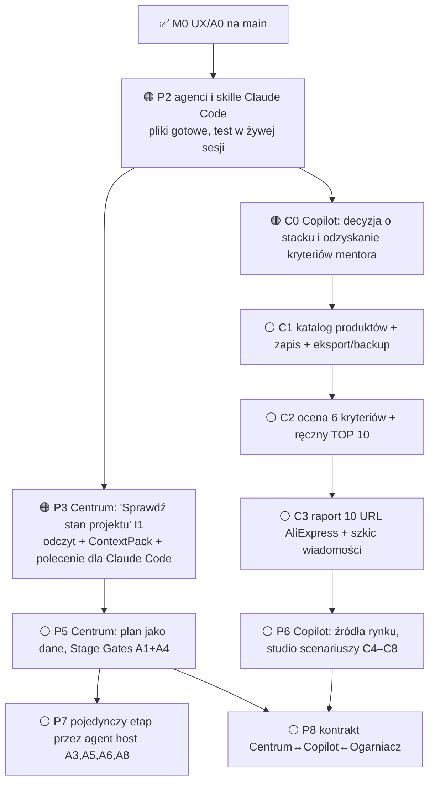

# Roadmapa ekosystemu: Centrum Projektowe + Osobisty Copilot + agenci

Stan: 2026-11-21. Legenda: ✅ zaimplementowane i sprawdzone · 🔵 w trakcie · 🟠 wymaga decyzji · 🔴 blokada · ⚪ zaplanowane/niezweryfikowane. Źródło założeń: Master Context 2026-11-21 (dokument wejściowy, nie jest w repo); stan faktyczny zweryfikowano w Git i kodzie.

## Stan rzeczywisty (zweryfikowany 2026-11-21)

| Obszar | Fakt | Dowód |
| --- | --- | --- |
| UX/A0 | ✅ **Już na `main`** (PR #1, commit scalający `b9e4e24`, 20:17 +0100). Master Context twierdził, że tylko na gałęzi — to nieaktualne. Drzewo `codex/ux-rescue-01` = drzewo `origin/main` (`git diff` puste) | `git log origin/main`, `git diff HEAD origin/main` |
| Jakość Centrum | ✅ lint, typecheck, test (web 298, hub), build — wszystkie exit 0 na `6a1798a` (drzewo identyczne z `main`) | przebieg lokalny 2026-11-21 |
| Skille Codex (4) | ✅ na `main`; nie zmieniane | `.agents/skills/` |
| Agenci/skille Claude Code | 🟠 pliki dodane w tym etapie (gałąź `claude/agenci-i-skille-01`, niewypchnięta); ładowanie w żywej sesji niesprawdzone | [ARCHITEKTURA](ARCHITEKTURA_AGENTOW.md), [EWALUACJE](EWALUACJE.md) |
| Wykonawca agentowy w aplikacji | ⚪ nie istnieje (Hub = health-check) | README, kod `apps/hub` |
| Osobisty Copilot | 🟠 lokalny `main` = zdalny `main` = `0cd656e`, czysto; **same dokumenty i prompty, zero kodu** | `git status`, brak `package.json`/`src` |
| Kryteria mentora (22) | 🟠 brak źródła w repo; `MODEL_DANYCH.md` ma 6 kryteriów rankingowych | wymaga oryginalnych wiadomości / archiwum ZIP |

## Mapa i kolejność

Zależności kluczowe: C0→C3 **nie czeka** na P5–P7 (MVP Copilota nie zależy od orkiestracji Centrum). P3 nie wymaga A4–A8, bo nie ma efektów ubocznych.

## Zestawienie etapów

| ID | Cel | Najmniejsze użyteczne wdrożenie | Kryterium odbioru | Decyzja człowieka |
| --- | --- | --- | --- | --- |
| P2 | własny system agentów | 5 agentów, 6 skilli, strażnik, testy | 🟠 pliki, strażnik i testy ✅; ładowanie w nowej sesji i zachowanie (E4–E6) do wykonania | zatwierdzenie commita/PR; uruchomienie E4–E6 |
| P3 / I1 | jeden przycisk „Sprawdź stan projektu” | strona/akcja składająca stan z istniejących projekcji + kopiowane polecenie `/audyt-repo` dla repo projektu | brak zapisu domeny, oznaczenie wieku danych, testy Start/Repozytoria | tak: wybór miejsca w UI |
| C0 | Copilot: fundament | audyt lokalny=zdalny ✅; **wybór stacku**; odzyskanie 22 kryteriów | zapisana decyzja (ADR lub dokument) | 🟠 stack i źródło kryteriów |
| C1–C3 | Copilot: zadanie mentora | 50 produktów → TOP 10 → raport 10 URL | `AKCEPTACJA.md` + E2E (restart, duplikaty, dokładnie 10, polskie znaki, backup) | zatwierdzenie TOP 10 zawsze ręczne |
| P5 | Stage Gates | A1 + A4: wersjonowany plan, bramki PASS/FAIL/BLOCKED | stary SHA/cancelled/brak dowodu ≠ PASS | zgoda na kontrakt |
| P7 | wykonanie etapu z aplikacji | A3,A5,A6,A8 po porównaniu SDK/MCP | audyt → plan → zgoda → patch → CI → odbiór | zakres autonomii (domyślnie odczyt + zatwierdzone pliki) |
| P6, P8 | rynek/studio; integracje | po MVP | wg `AKCEPTACJA.md` Copilota | źródła i konta autoryzowane |

## Szybsza ścieżka wartości (zamiast sekwencji A1–A9)

1. **Teraz:** workflow ręczny przez skille (✅) — daje 80% scenariusza „jednym poleceniem”, bez ryzyka efektów ubocznych w aplikacji.
2. **I1:** przycisk tylko do odczytu (raport + polecenie).
3. Dopiero potem Stage Gates, a na końcu wykonawca. Każdy kolejny poziom wymaga dowodu poprzedniego.

## Copilot — porównanie stacków do decyzji C0 (propozycja, nie wybór)

| Wariant | Plusy | Minusy |
| --- | --- | --- |
| A. React+Vite+TS (jak Centrum) + lokalny Node + SQLite | wspólna wiedza i komponenty, plik bazy łatwy do backupu i skryptów agentów, praca bez przeglądarkowego originu | trzeba mały backend; sprawdzić dojrzałość `node:sqlite` w Node 24 lub użyć utrzymywanego sterownika |
| B. Next.js full-stack + SQLite | jeden projekt, SSR/API w pakiecie | cięższy framework, mniej zbieżny z Centrum |
| C. Streamlit | najszybszy prototyp tabel/wykresów | słabszy UX i testy E2E, inny język, trudniejsze Domain Packs |

Wstępna rekomendacja do weryfikacji: **A** (zgodność z ekosystemem, trwały plik SQLite poza originem przeglądarki, łatwy eksport CSV z BOM). Nie wprowadzać żadnego stacku przed decyzją.

## Skill-e domenowe Copilota — kiedy

Dopiero z modułem, który obsługują (`/ocen-produkt` z C2, `/raport-mentora` z C3, dalsze po MVP). Nie tworzymy ich wcześniej.

## Lista decyzji dla człowieka

1. 🟠 Czy zatwierdzić i opublikować gałąź `claude/agenci-i-skille-01` (commit, push, PR)? Nic nie zostało wypchnięte.
2. 🟠 C0: wybór stacku Copilota (A/B/C) oraz dostarczenie oryginału zadania mentora i listy 22 kryteriów.
3. 🟠 P3: gdzie w UI ma być „Sprawdź stan projektu” (Start czy karta projektu).
4. 🟠 Czy po zatwierdzeniu usunąć lokalną gałąź `codex/ux-rescue-01` (już scalona w `main`) — nie robiono tego.
